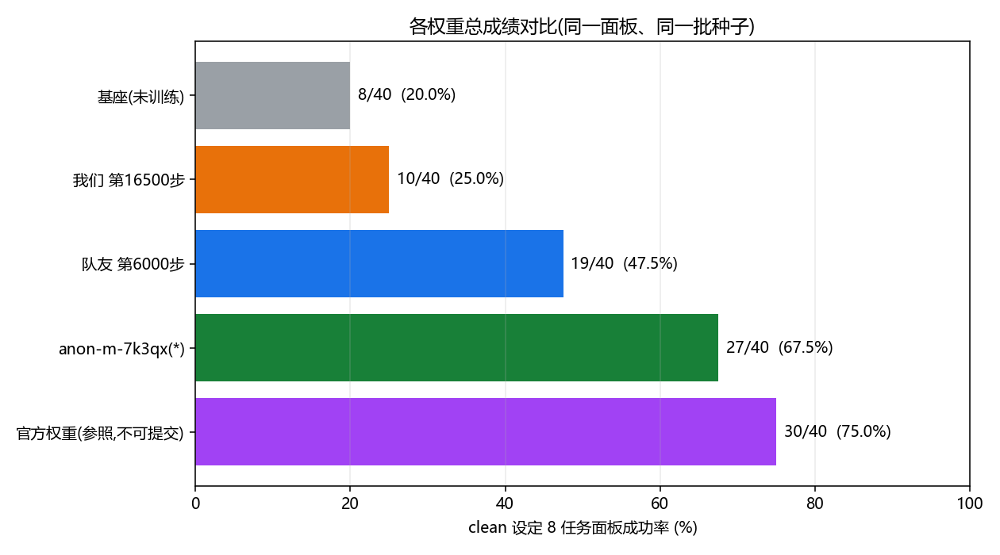
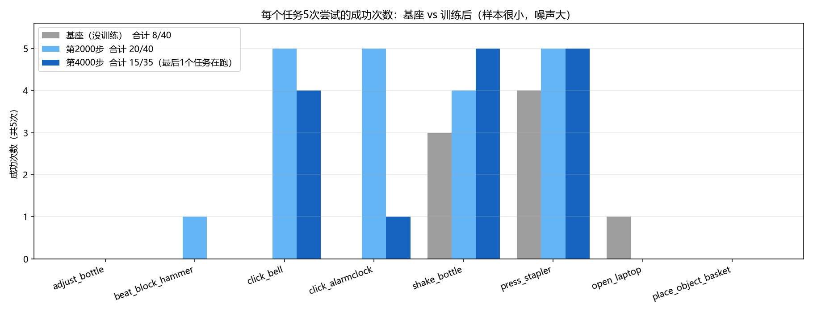
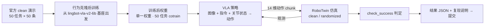

<div align="center">

# LingBot-VLA 2.0 × RoboTwin

**蚂蚁灵波具身大模型挑战赛（天池）初赛参赛记录**

仅用官方 clean 演示数据对 6.38B VLA 基座做行为克隆后训练，在 RoboTwin 仿真环境完成 50 任务闭环评测 —— 附完整复现文档、踩坑复盘与评测产物

[](https://github.com/Larryhul/lingbot-vla-2-robotwin/stargazers)
[](LICENSE)
[](https://tianchi.aliyun.com/competition/entrance/532514/information)
[](docs/)
[](https://github.com/Larryhul/lingbot-vla-2-robotwin/pulls)

**简体中文** | [English](README_EN.md)

</div>

---

## 📑 目录

- [📌 项目简介](#-项目简介)
- [🌟 亮点速览](#-亮点速览)
- [🏆 成绩总览](#-成绩总览)
- [🎬 演示视频](#-演示视频)
- [🧪 方案与训练](#-方案与训练)
- [🐛 关键复盘：56.6% → 77.96%](#-关键复盘566--7796)
- [📮 踩坑清单](#-踩坑清单)
- [🚀 快速开始](#-快速开始)
- [📁 目录结构](#-目录结构)
- [🖥️ 评测环境](#️-评测环境)
- [❓ 已知问题与如实说明](#-已知问题与如实说明)
- [📄 License 与引用](#-license-与引用)
- [🙏 致谢与参考](#-致谢与参考)

## 📌 项目简介

本仓库记录了天池「蚂蚁灵波具身大模型挑战赛」初赛的完整参赛过程。任务设定：

- **模型**：官方基座 [`robbyant/lingbot-vla-v2-6b`](https://huggingface.co/robbyant/lingbot-vla-v2-6b)（6.38B 参数，Qwen3-VL-4B 主干 + MoE 动作专家，流匹配动作 chunk 50×14）
- **数据**：RoboTwin 2.0 Aloha-AgileX **50 任务 × 50 条 clean 演示**（共 2,500 条轨迹 / 549,787 帧）。按规则**只允许 clean 数据**：禁用 randomized / 外部 / 仿真 rollout 数据，禁用 unseen 指令
- **训练**：监督行为克隆（BC）后训练；单一权重联合训练 50 任务，推理不按任务路由、无集成、无多 seed 投票
- **评测**：RoboTwin 闭环仿真，clean（seen 指令）与 randomized（unseen 指令）两种设定，成功判定为环境自带 `check_success()`

> 本仓库**不是**模型代码的复刻，而是参赛记录：基线复现、一个价值 21.4 分的评测 bug 定位、训练配方、评测管线、候选权重对比与最终提交结果。官方源码见文末链接。

## 🌟 亮点速览

1. **🐛 一个价值 21.4 分的评测 bug** —— 基线 56.6% 与官方宣称的 93.52% 差距悬殊，逐层排查后定位到「96% 的回合把任务名当语言指令下发」的评测管线缺陷，修复后 **56.60% → 77.96%**。完整因果链 + 三层证据 + 排除法见[关键复盘](#-关键复盘566--7796)。
2. **🔬 受控实验思维** —— 每个假设都有对照轮：`use_length` 25 vs 50、compile 开关被对照实验排除（56.4% ≈ 56.6%），不凭感觉归因。
3. **🪞 诚实记录** —— 测试次数不足官方要求就如实标注 `not_run`；训练更久反而退化的负结果、评测缓存引入的误判全部保留，不美化。
4. **📦 完整可复现** —— 训练配置、权重转换脚本、已执行的复现 notebook（含真实输出）、逐任务结果文件全部开源。

## 🏆 成绩总览

### 最终提交

| 项目 | 内容 |
|---|---|
| 权重 | `anon-m-7k3qx`（HF bf16，3 个 safetensors 分片，约 12.8 GB，ModelScope: `oasmet/anon-m-7k3qx`） |
| 训练方式 | 全参数微调，50 任务 clean-only 联合训练（cotrain） |
| clean 设定 | **40/50 个任务有结果，136 回合成功 56（41.2%）**；8 个面板任务每任务 5 次，其余每任务 3 次 |
| randomized 设定 | 部分任务（详见 [`results/`](results/) 中的 JSON） |
| 结果文件 | [`results_anon-m-7k3qx.json`](results/results_anon-m-7k3qx.json) · [`results/README.md`](results/README.md) |

> ⚠️ 受共用服务器显存 / 磁盘限制，**未完成官方要求的每任务每设定 100 次**，未测任务标 `not_run` 不计成功。最终以官方复测成绩为准。

### 关键数字

| 里程碑 | clean 成绩 | 说明 |
|---|---|---|
| 官方基线（未训练） | 56.60%（1415/2500） | 50 任务 × 50 回合全量评测 |
| **修复指令 bug 后** | **77.96%（1949/2500）** | **+21.4 分**，7 任务满分，0% 任务清零 |
| 官方后训练权重（仅对照，不合规） | ≈ 75%（8 任务面板） | 用于校准评测环境，未参与训练与提交 |

### 候选权重对比（8 任务面板，每任务 5 次）

| 候选 | clean 面板 | 备注 |
|---|---|---|
| 官方基座（未训练） | 8/40 | — |
| 仅动作专家 · 第 2000 步 | 20/40 | 动作专家约 1.8B，主干冻结 |
| 仅动作专家 · 第 16500 步 | 10/40 | **训练更久反而退化** |
| 全参微调 · 第 6000 步 | 19/40 | 有效批量 128 |
| 官方后训练权重 | 30/40 | 仅作评测环境校准对照 |

> 💡 **教训：最后一步 ≠ 最好。**候选选择必须基于同协议评测，loss 下降不等于成功率上升。详见 [`docs/model-selection.md`](docs/model-selection.md)。

<p align="center">
  
  
</p>
<p align="center"><i>左：各候选权重总成绩；右：逐任务成功率对比</i></p>

## 🎬 演示视频

**成功操作汇总（3 倍速）** —— [`videos/success_compilation_3x.mp4`](videos/success_compilation_3x.mp4)

**基座 vs 训练后对比** —— [`click_bell`](videos/click_bell_base_vs_trained.mp4) · [`click_alarmclock`](videos/click_alarmclock_base_vs_trained.mp4)

**逐任务成功 / 失败示例** —— [`videos/success_examples/`](videos/success_examples/)（含 `open_laptop` 的成功与失败对照、`shake_bottle`、`press_stapler` 等 8 段）

## 🧪 方案与训练



### 训练配方（最终提交路线）

| 项目 | 配置 |
|---|---|
| 起点 | `robbyant/lingbot-vla-v2-6b` 基座（规则红线：禁止使用 `*-robotwin` 后训练权重作起点） |
| 方式 | 全参数微调（`train_expert_only=false`，无 LoRA） |
| 批量 | 有效批量 128（micro 64 × 梯度累积 2） |
| 优化器 | AdamW；5000 步后学习率固定 1e-6 |
| 数据 | 仅 clean 2500 条 + seen 指令池；归一化统计用 clean 数据自算（`robotwin_clean_2500_norm_stats.json`），不使用混有 randomized 的官方统计 |
| 备选路线 | 仅训练动作专家（约 1.8B，批量 8，16,500 步）——显存受限时的方案，实测较弱 |

完整复现参数见 [`docs/reproduction-notes.md`](docs/reproduction-notes.md)，训练环境搭建见 [`docs/training-guide.md`](docs/training-guide.md)。

## 🐛 关键复盘：56.6% → 77.96%

官方基座全量评测只有 **56.6%**，与官方宣称的 93.52% 相差悬殊。排查结论：**评测管线的指令生成失败**——`expert_check=false` 时 `episode_info` 被硬编码为空，导致 96% 的回合把任务名字符串（如 `"adjust_bottle"`）直接当语言指令下发。

```
runner 传 --expert_check false（官方客户端硬编码 True）
  → episode_info = {"info": {}} 硬编码空
  → build_instruction 找不到字段 → "No valid instructions found"
  → 兜底："using task name as instruction"
  → 2500 个回合中 2404 个（96%）拿到的是任务名而非真实指令
```

**三层证据**：① 代码定位到 `eval_policy_xpolicylab.py` 的硬编码分支；② 日志统计 2404/2500 命中兜底；③ 症状吻合——指令无关任务（`shake_bottle` 等）照常 100%，吃指令语义的任务（按颜色/尺寸排序、堆叠系列）塌方到 0–18%。

**排除法**：`use_length` 25 vs 50、compile 开关的对照轮 56.4% ≈ 56.6%，5 个 0% 任务原封不动 —— 与差距无关。

**修复**：干跑（dry-run）patch——把 7 个执行原语 stub 成 no-op 后跑 `play_once()`，只渲染指令模板、不执行轨迹（ROCm 环境装不了 CuRobo，无法走 `expert_check=true` 正路）。

完整分析：[`docs/FROM-56-TO-80.md`](docs/FROM-56-TO-80.md) · 逐任务对比：[`docs/dryrun-vs-run2-comparison.md`](docs/dryrun-vs-run2-comparison.md)

## 📮 踩坑清单

| 坑 | 现象 | 解法 |
|---|---|---|
| 评测指令退化 | 96% 回合用任务名当指令，语义类任务塌方 | 干跑 patch 修复指令模板渲染（+21.4 分） |
| 专家试玩缓存误判 | `open_laptop`、`place_object_scale`、`put_object_cabinet` 被误判失败 | 对这 3 个任务关闭缓存 |
| 训练步数迷信 | 第 16500 步（10/40）远差于第 2000 步（20/40） | 同协议评测选 checkpoint，不看 loss 选 |
| ROCm 编译写爆 `/tmp` | `LLVM ERROR: No space left on device`（`/tmp` 是 4G tmpfs） | `TMPDIR` 指向大盘并清理 `comgr-*` 缓存 |
| 渲染偶发卡死 | 约每几十局一次 | 守护脚本终止重跑，不计入成绩 |
| 共用 GPU 资源竞争 | 显存不足导致分配失败 | 该批次作废重跑，限制自身显存 / CPU 占用 |

## 🚀 快速开始

**前置**：NVIDIA GPU（≥ 96GB 显存可跑全参微调；更小可用仅动作专家路线）、PyTorch 2.8.0+cu128、[RoboTwin 2.0](https://huggingface.co/datasets/TianxingChen/RoboTwin2.0) 环境、[lingbot-vla-v2](https://github.com/Robbyant/lingbot-vla-v2) 源码。

```bash
# 1. 克隆本仓库
git clone https://github.com/Larryhul/lingbot-vla-2-robotwin.git
cd lingbot-vla-2-robotwin

# 2. 准备数据清单（50 任务 × 50 条 clean 演示，LeRobot v3.0 格式）
#    清单模板见 training/robotwin_clean_50.txt，将路径替换为实际数据位置

# 3. 训练（配置模板见 training/）
bash training/train_full_sft.sh          # 全参数微调（最终提交路线）
# 或参考 training/lingbotvla_cli_100steps.yaml 做 100 步冒烟验证

# 4. 权重格式转换（DCP → HF / LoRA 合并）
python scripts/convert_full_sft_dcp.py   # 全参 DCP → HF safetensors
python scripts/merge_lora_dcp.py         # LoRA 权重合并

# 5. 推理服务 + 评测
bash scripts/launch_official_server.sh   # 启动推理服务
python scripts/benchmark_official_inference.py   # 推理延迟基准
python scripts/make_results_json.py      # 汇总生成提交格式 JSON
```

分步骤的详细说明（数据转换、归一化统计、评测协议、推理参数）见 [`docs/training-guide.md`](docs/training-guide.md) 与 [`docs/reproduction-notes.md`](docs/reproduction-notes.md)。ROCm / 多卡环境的全链路复现请看 [`notebooks/RoboTwin_ROCm_Reproduction.executed.ipynb`](notebooks/RoboTwin_ROCm_Reproduction.executed.ipynb)（已执行版本，含真实输出）。

如果你是第一次接触这个赛题，先读 [`docs/getting-started.md`](docs/getting-started.md)：赛题解读、角色关系、数据形态、实验方法论。

## 📁 目录结构

```
lingbot-vla-2-robotwin/
├── README.md / README_EN.md      # 本文件 / English version
├── docs/
│   ├── getting-started.md        # 赛题解读、执行计划、实验方法论
│   ├── training-guide.md         # 训练复现指南（数据→配置→启动→导出）
│   ├── FROM-56-TO-80.md          # 指令 bug 完整因果链与修复（核心复盘）
│   ├── clean50x50-result.md      # 基线 56.6% 全量评测明细
│   ├── dryrun-vs-run2-comparison.md   # 修复前后逐任务对比（+21.4 分）
│   ├── reproduction-notes.md     # 提交用复现说明（训练/评测/推理参数）
│   └── model-selection.md        # 候选权重同协议对比与结论
├── results/                      # 最终提交的测试结果（JSON/TSV + 提交说明）
├── scripts/                      # 权重转换、推理基准、结果打包
├── training/                     # 训练配置 yaml、启动脚本、数据清单
├── notebooks/                    # ROCm 全链路复现 notebook（已执行）
├── figures/                      # 训练损失曲线、成功率对比等图表
└── videos/                       # 成功/失败示例、基座 vs 训练后对比
```

## 🖥️ 评测环境

| 项目 | 配置 |
|---|---|
| 评测机 | NVIDIA RTX PRO 6000 Blackwell（96 GB，多人共用），Ubuntu 24.04 |
| 框架 | torch 2.8.0+cu128 |
| 仿真 | RoboTwin @ `266f3aad`，XPolicyLab @ `c37109c` |
| 运动规划 | CuRobo v0.7.8 针对 sm_120 用 CUDA 12.8 工具链重编译 |
| 渲染 | 降噪器 OptiX（OIDN 在该环境不可用，画面可能与官方略有差异） |
| 推理参数 | bf16，不 compile，`chunk=50`，`use_length=25`，无 temporal ensemble / smoothing / replanning |
| 评测协议 | clean2clean（`demo_clean` + seen 指令）、clean2random（`demo_randomized` + unseen 指令），seed 起点 100000，`expert_check=true` |
| 环境校准 | 官方后训练权重 8 任务面板约 75%（对照团队同任务约 84%，误差范围内一致） |
| 基线复现机 | 4× AMD gfx1100 48G（ROCm），50×50 全量评测耗时 6h50m，单步推理约 0.77 s |

## ❓ 已知问题与如实说明

- **测试次数不足**：未达官方要求的每任务每设定 100 次；每任务 3–5 次时单任务噪声很大（面板整体误差约 ±7 个百分点）。
- **渲染差异**：降噪器为 OptiX 而非官方默认 OIDN；点击类任务在本环境偏低，原因未查明。
- **资源竞争**：评测与他人任务共用 GPU，因显存不足失败的批次已作废重跑。
- **归一化敏感**：同一权重换归一化文件，面板成绩 27/40 vs 21/40，差异可能来自统计文件也可能只是噪声。
- **负结果保留**：仅动作专家路线、更长训练步数等无效/负向尝试均已如实记录。

## 📄 License 与引用

本仓库代码与文档采用 [MIT License](LICENSE)。官方模型代码、权重、数据集的版权归各自作者所有，遵循其原始许可。

如果这个仓库对你的研究或比赛有帮助，欢迎引用：

```bibtex
@misc{lingbot_vla_2_robotwin_2026,
  title        = {LingBot-VLA 2.0 × RoboTwin Competition Notes},
  author       = {Larryhul},
  year         = {2026},
  howpublished = {\url{https://github.com/Larryhul/lingbot-vla-2-robotwin}}
}
```

## 🙏 致谢与参考

- [Robbyant/lingbot-vla-v2](https://github.com/Robbyant/lingbot-vla-v2) —— 官方模型代码（本仓库不含其源码副本）
- [robbyant/lingbot-vla-v2-6b](https://huggingface.co/robbyant/lingbot-vla-v2-6b) —— 官方预训练基座
- [TianxingChen/RoboTwin2.0](https://huggingface.co/datasets/TianxingChen/RoboTwin2.0) —— 仿真数据集
- [天池比赛页面](https://tianchi.aliyun.com/competition/entrance/532514/information) —— 赛题与规则

---

<div align="center">
  如果这个仓库对你有帮助，欢迎 ⭐ Star 支持一下 · <a href="README_EN.md">English README</a>
</div>
