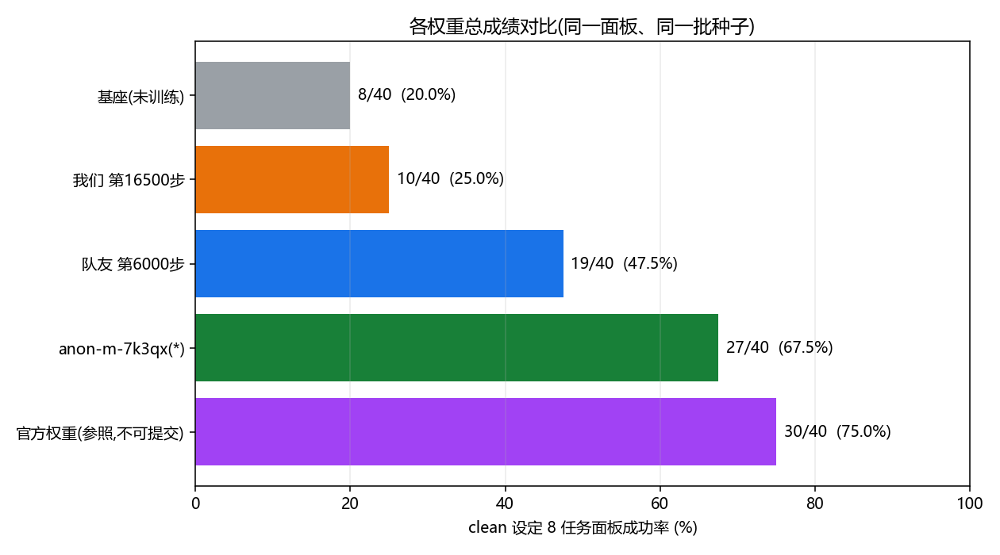
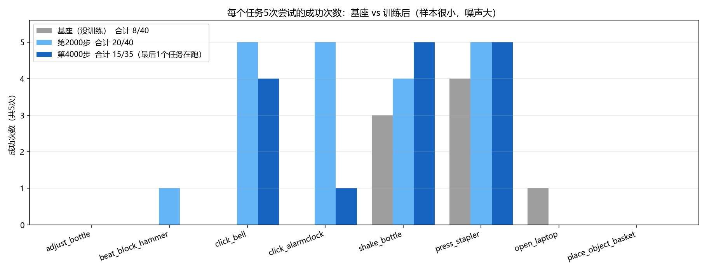
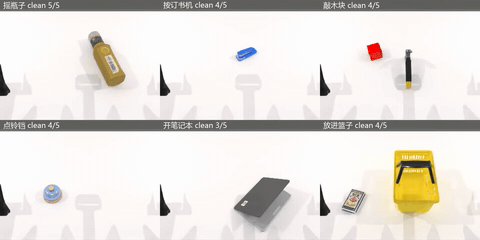
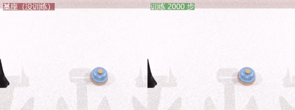
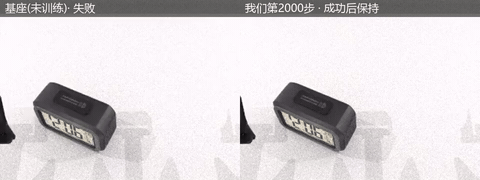
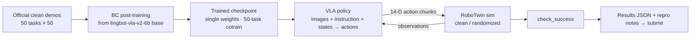

<div align="center">

# LingBot-VLA 2.0 × RoboTwin

**Competition Notes — Tianchi LingBot-VLA Embodied AI Challenge (Preliminary)**

Behavior-cloning post-training of a 6.38B VLA base model on official clean demos only, closed-loop evaluation on 50 RoboTwin tasks — with full reproduction docs, debugging postmortems and evaluation artifacts

[](https://github.com/Larryhul/lingbot-vla-2-robotwin/stargazers)
[](LICENSE)
[](https://tianchi.aliyun.com/competition/entrance/532514/information)
[](https://github.com/Larryhul/lingbot-vla-2-robotwin/pulls)

[简体中文](README.md) | **English**

</div>

---

## Table of Contents

- [Overview](#overview)
- [Highlights](#highlights)
- [Results](#results)
- [Demo Videos](#demo-videos)
- [Method & Training](#method--training)
- [Postmortem: 56.6% → 77.96%](#postmortem-566--7796)
- [Pitfall Checklist](#pitfall-checklist)
- [Quick Start](#quick-start)
- [Repository Layout](#repository-layout)
- [Evaluation Environment](#evaluation-environment)
- [Known Issues & Honest Caveats](#known-issues--honest-caveats)
- [License & Citation](#license--citation)
- [Acknowledgements](#acknowledgements)

## Overview

This repository documents our participation in the preliminary round of the Tianchi LingBot-VLA Embodied AI Challenge:

- **Model**: official base [`robbyant/lingbot-vla-v2-6b`](https://huggingface.co/robbyant/lingbot-vla-v2-6b) (6.38B params, Qwen3-VL-4B backbone + MoE action expert, flow-matching action chunks of 50×14)
- **Data**: RoboTwin 2.0 Aloha-AgileX **50 tasks × 50 clean demos** (2,500 trajectories / 549,787 frames). Rules allow **clean data only** — no randomized / external / rollout data, no unseen instructions
- **Training**: supervised behavior cloning (BC); a single checkpoint trained jointly on all 50 tasks — no task routing, no ensembling, no multi-seed voting
- **Evaluation**: closed-loop RoboTwin simulation in clean (seen instructions) and randomized (unseen instructions) settings, judged by the environment's built-in `check_success()`

This is **not** a re-implementation of the model code — it is a competition record: baseline reproduction, the debugging of an evaluation bug worth 21.4 points, training recipes, the evaluation pipeline, checkpoint comparisons and final submission results.

## Highlights

1. **🐛 An evaluation bug worth 21.4 points** — the baseline scored 56.6% vs. the officially claimed 93.52%. Root cause: 96% of episodes received the *task name* as the language instruction. After the fix: **56.60% → 77.96%**. Full causal chain and evidence in [Postmortem](#postmortem-566--7796).
2. **🔬 Controlled experiments** — every hypothesis got a control run; `use_length` 25 vs. 50 and compile on/off were ruled out empirically (56.4% ≈ 56.6%).
3. **🪞 Honest reporting** — under-tested tasks are marked `not_run` and never counted as successes; negative results (longer training hurting performance, eval-cache misjudgments) are preserved as-is.
4. **📦 Fully reproducible** — training configs, weight-conversion scripts, an executed reproduction notebook (with real outputs) and per-task result files are all included.

## Results

### Final Submission

| Item | Detail |
|---|---|
| Checkpoint | `anon-m-7k3qx` (HF bf16, 3 safetensors shards, ~12.8 GB, ModelScope: `oasmet/anon-m-7k3qx`) |
| Training | full fine-tuning, clean-only joint training on 50 tasks |
| clean setting | **40/50 tasks tested, 56 successes in 136 episodes (41.2%)**; 8 panel tasks × 5 episodes, the rest × 3 |
| randomized setting | partial (see JSON in [`results/`](results/)) |
| Result files | [`results_anon-m-7k3qx.json`](results/results_anon-m-7k3qx.json) · [`results/README.md`](results/README.md) |

> ⚠️ Due to shared GPU / disk limits we did **not** complete the requested 100 episodes per task per setting. Untested tasks are marked `not_run` and count as failures. Official re-evaluation results are authoritative.

### Key Numbers

| Milestone | clean score | Notes |
|---|---|---|
| Official base (untrained) | 56.60% (1415/2500) | full 50 tasks × 50 episodes |
| **After instruction-bug fix** | **77.96% (1949/2500)** | **+21.4 pts**, 7 tasks perfect, no task left at 0% |
| Official post-trained ckpt (reference only, non-compliant) | ≈ 75% (8-task panel) | used to calibrate the eval environment only |

### Checkpoint Comparison (8-task panel, 5 episodes each)

| Candidate | clean panel | Note |
|---|---|---|
| Official base (untrained) | 8/40 | — |
| Action-expert-only · step 2000 | 20/40 | ~1.8B params, frozen backbone |
| Action-expert-only · step 16500 | 10/40 | **longer training hurt** |
| Full fine-tune · step 6000 | 19/40 | effective batch 128 |
| Official post-trained ckpt | 30/40 | calibration reference only |

> 💡 **The last checkpoint is not the best checkpoint.** Selection must use same-protocol evaluation; falling loss ≠ rising success rate. See [`docs/model-selection.md`](docs/model-selection.md) (Chinese).

<p align="center">
  
  
</p>

## Demo Videos

<p align="center">
  <a href="videos/success_compilation_3x.mp4">
    
  </a>
  <br><i>Success compilation (3× speed) — click for the full video</i>
</p>

<table>
<tr>
<td align="center" width="50%">
  <a href="videos/click_bell_base_vs_trained.mp4"></a>
  <br><sub>click_bell: base vs. trained (click for full video)</sub>
</td>
<td align="center" width="50%">
  <a href="videos/click_alarmclock_base_vs_trained.mp4"></a>
  <br><sub>click_alarmclock: base vs. trained (click for full video)</sub>
</td>
</tr>
</table>

**Per-task examples** — [`videos/success_examples/`](videos/success_examples/) (success/failure pairs for `open_laptop`, `shake_bottle`, `press_stapler`, and more)

## Method & Training



| Item | Config |
|---|---|
| Starting point | `robbyant/lingbot-vla-v2-6b` base (rules forbid the `*-robotwin` post-trained weights as a starting point) |
| Method | full fine-tuning (`train_expert_only=false`, no LoRA) |
| Batch | effective 128 (micro 64 × grad accumulation 2) |
| Optimizer | AdamW; learning rate fixed at 1e-6 after step 5000 |
| Data | clean 2500 trajectories + seen instruction pool; normalization stats recomputed from clean data |
| Fallback route | action-expert-only (~1.8B, batch 8, 16,500 steps) — weaker in practice |

## Postmortem: 56.6% → 77.96%

Root cause: the evaluation pipeline silently substituted **task names for language instructions** — `expert_check=false` hardcodes an empty `episode_info`, so `build_instruction()` falls back to the task name string (e.g. `"adjust_bottle"`) in 2404/2500 episodes.

```
runner passes --expert_check false (official client hardcodes True)
  → episode_info = {"info": {}} hardcoded empty
  → build_instruction finds no fields → "No valid instructions found"
  → fallback: "using task name as instruction"
  → 2404/2500 episodes (96%) get a task name instead of a real instruction
```

Three layers of evidence: code path inspection, log statistics (2404/2500 fallbacks), and symptom match (instruction-agnostic tasks stayed at 100% while instruction-dependent sorting/stacking tasks collapsed to 0–18%). Control runs ruled out `use_length` and compile (56.4% ≈ 56.6%).

**Fix**: a dry-run patch that stubs 7 execution primitives to no-ops and runs `play_once()` purely to render instruction templates (CuRobo is unavailable on the ROCm machine, so `expert_check=true` was not an option).

Details: [`docs/FROM-56-TO-80.md`](docs/FROM-56-TO-80.md) · per-task diff: [`docs/dryrun-vs-run2-comparison.md`](docs/dryrun-vs-run2-comparison.md) (Chinese).

## Pitfall Checklist

| Pitfall | Symptom | Fix |
|---|---|---|
| Instruction degradation | 96% of episodes got task names; semantic tasks collapsed | dry-run patch to render instruction templates (+21.4 pts) |
| Expert-play cache misjudgment | `open_laptop`, `place_object_scale`, `put_object_cabinet` falsely failed | disabled cache for these 3 tasks |
| "More steps is better" | step 16500 (10/40) ≪ step 2000 (20/40) | select checkpoints by same-protocol eval, not by loss |
| ROCm compile filling `/tmp` | `LLVM ERROR: No space left on device` (4G tmpfs) | set `TMPDIR` to a big disk, clean `comgr-*` |
| Occasional render hangs | roughly once every few dozen episodes | watchdog kills & reruns; excluded from scores |
| Shared GPU contention | OOM allocation failures | batch discarded and rerun; capped own GPU/CPU usage |

## Quick Start

**Prerequisites**: NVIDIA GPU (≥ 96 GB for full fine-tuning; smaller works with the action-expert route), PyTorch 2.8.0+cu128, [RoboTwin 2.0](https://huggingface.co/datasets/TianxingChen/RoboTwin2.0) environment, [lingbot-vla-v2](https://github.com/Robbyant/lingbot-vla-v2) source code.

```bash
git clone https://github.com/Larryhul/lingbot-vla-2-robotwin.git
cd lingbot-vla-2-robotwin

# 1. Prepare the data manifest (50 tasks × 50 clean demos, LeRobot v3.0)
#    template: training/robotwin_clean_50.txt — replace with your data paths

# 2. Train (config templates in training/)
bash training/train_full_sft.sh
# or smoke-test 100 steps with training/lingbotvla_cli_100steps.yaml

# 3. Convert checkpoints (DCP → HF / LoRA merge)
python scripts/convert_full_sft_dcp.py
python scripts/merge_lora_dcp.py

# 4. Serve + evaluate
bash scripts/launch_official_server.sh
python scripts/benchmark_official_inference.py
python scripts/make_results_json.py
```

Step-by-step details are in [`docs/training-guide.md`](docs/training-guide.md) and [`docs/reproduction-notes.md`](docs/reproduction-notes.md) (Chinese). For a full ROCm / multi-GPU walkthrough see [`notebooks/RoboTwin_ROCm_Reproduction.executed.ipynb`](notebooks/RoboTwin_ROCm_Reproduction.executed.ipynb) (executed, with real outputs). New to the challenge? Start with [`docs/getting-started.md`](docs/getting-started.md).

## Repository Layout

```
lingbot-vla-2-robotwin/
├── README.md / README_EN.md      # Chinese / English
├── docs/                         # getting-started, training-guide, postmortems, repro notes
├── results/                      # final submitted results (JSON/TSV + notes)
├── scripts/                      # weight conversion, inference benchmark, result packaging
├── training/                     # training configs, launch scripts, data manifest
├── notebooks/                    # executed ROCm reproduction notebook
├── figures/                      # loss curves, success-rate comparisons
└── videos/                       # success/failure examples, base-vs-trained comparisons
```

## Evaluation Environment

| Item | Config |
|---|---|
| Machine | NVIDIA RTX PRO 6000 Blackwell (96 GB, shared), Ubuntu 24.04 |
| Framework | torch 2.8.0+cu128 |
| Simulation | RoboTwin @ `266f3aad`, XPolicyLab @ `c37109c` |
| Motion planning | CuRobo v0.7.8 rebuilt for sm_120 with CUDA 12.8 |
| Rendering | OptiX denoiser (OIDN unavailable; visuals may differ slightly from official) |
| Inference | bf16, no compile, `chunk=50`, `use_length=25`, no temporal ensemble / smoothing / replanning |
| Protocol | clean2clean (`demo_clean` + seen) and clean2random (`demo_randomized` + unseen), seed from 100000, `expert_check=true` |
| Calibration | official post-trained ckpt ≈ 75% on the 8-task panel (baseline team ≈ 84%, consistent within error) |
| Baseline machine | 4× AMD gfx1100 48G (ROCm); 50×50 eval took 6h50m, ~0.77 s/step inference |

## Known Issues & Honest Caveats

- **Episode counts far below spec** (3–5 per task instead of 100); single-task noise is large (±7 pts on the panel).
- **Rendering differs** from the official setup (OptiX vs. OIDN); click-type tasks score lower here, cause unknown.
- **Shared GPU**: batches lost to OOM were discarded and rerun.
- **Normalization sensitivity**: swapping norm-stat files moved the panel from 27/40 to 21/40 — may be noise.
- **Negative results kept**: ineffective routes (action-expert-only, longer training) are recorded as-is.

## License & Citation

Code and docs in this repository are under the [MIT License](LICENSE). Official model code, weights and datasets belong to their respective owners under their original licenses.

```bibtex
@misc{lingbot_vla_2_robotwin_2026,
  title        = {LingBot-VLA 2.0 × RoboTwin Competition Notes},
  author       = {Larryhul},
  year         = {2026},
  howpublished = {\url{https://github.com/Larryhul/lingbot-vla-2-robotwin}}
}
```

## Acknowledgements

- [Robbyant/lingbot-vla-v2](https://github.com/Robbyant/lingbot-vla-v2) — official model code (not vendored here)
- [robbyant/lingbot-vla-v2-6b](https://huggingface.co/robbyant/lingbot-vla-v2-6b) — official pretrained base
- [TianxingChen/RoboTwin2.0](https://huggingface.co/datasets/TianxingChen/RoboTwin2.0) — simulation dataset
- [Tianchi challenge page](https://tianchi.aliyun.com/competition/entrance/532514/information) — tasks & rules

---

<div align="center">
  If you find this repository useful, please consider giving it a ⭐ · <a href="README.md">中文 README</a>
</div>
