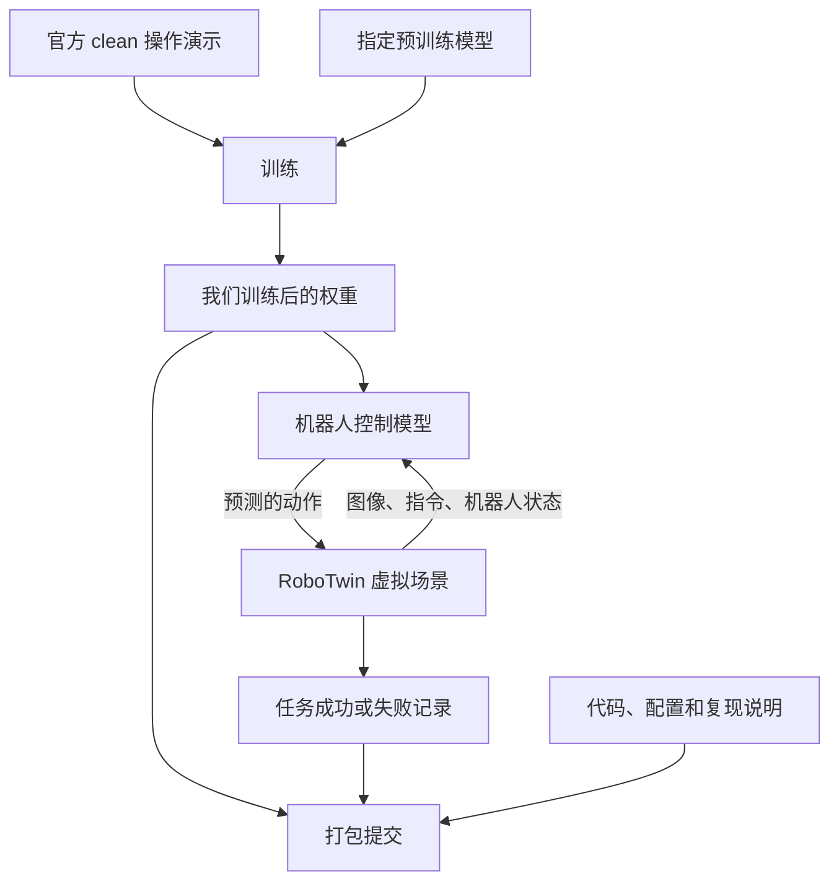

# 蚂蚁灵波具身大模型挑战赛：入门指南

更新日期：2026-10-07。用途：解释比赛目标和执行步骤；实际完成情况见同目录的《参赛进度.md》。

## 1. 我们要做出什么

使用主办方指定的 LingBot-VLA 2.0 预训练模型，学习官方允许的机器人演示数据，让机器人在 RoboTwin 仿真环境中根据图像、语言指令和自身状态完成操作任务。最终交付训练后的模型权重、真实评测结果、代码及可复现说明。

初赛的主要工作是仿真任务；真实机器人创新 Demo 是可选补充。晋级后的决赛是真机挑战，设备由主办方提供，具体任务和约束以赛前通知为准。

来源：[天池赛题与数据](https://tianchi.aliyun.com/competition/entrance/532514/information)。



## 2. 先看一个具体例子

示意任务：把桌上的瓶子放到指定位置。下面用于解释机器人如何工作，不代表某个具体赛题的全部成功判定。

1. 仿真器摆好虚拟桌面、瓶子和机械臂，并提供相机图像。
2. 系统给模型输入语言指令、图像和机器人当前状态。
3. 模型预测接下来一段动作，例如关节位置和夹爪开合目标。
4. 控制器把这些动作交给虚拟机器人执行。
5. 仿真器产生新的图像和状态，模型再决定后续动作。
6. 达到任务条件、失败或者超时后，记录这一轮结果。

关键点：机器人要连续完成观察、行动和再次观察。单帧识别正确，并不代表整项操作成功。

## 3. 比赛中的几个角色

| 名称 | 通俗含义 | 在项目中负责什么 |
|---|---|---|
| LingBot-VLA 2.0 | 机器人的控制模型 | 根据视觉、语言和状态预测动作 |
| RoboTwin | 虚拟练习场与考试环境 | 模拟机器人和物体，提供观测并判断成功 |
| 官方 clean 演示 | 正确操作范例 | 提供训练监督信号 |
| 模型代码 | 模型的计算方法 | 定义模型、数据读取、训练和推理流程 |
| 模型权重 | 模型通过学习得到的参数 | 决定同样输入下预测怎样的动作 |
| GPU 服务器 | 运行大模型的计算设备 | 训练、推理，部分仿真渲染也使用 GPU |
| LeRobot 格式 | 机器人数据的统一组织方式 | 把视频、状态、动作和索引组织成训练程序能读取的格式 |

VLA 分别代表 Vision、Language、Action，即视觉、语言和动作。最终输出是机器人动作数值，而不是一段聊天回复。

本地参考配置包含顶视、左腕、右腕三路相机，以及机械臂和夹爪的状态映射。实际相机画面、动作字段和时间对齐，需要在真实数据准备好后逐条抽查。

## 4. 数据到底是什么

一条演示轨迹是一次操作过程的连续记录。可以把它想象成带有控制记录的教学视频：不仅有每一时刻看到的画面，还包含机器人当时的状态以及示范动作。

按目前天池公开要求，训练使用 Aloha-AgileX 的 50 个任务，每个任务 50 条 clean 演示，共 2,500 条轨迹。轨迹内通常有多个时刻，所以 2,500 条轨迹不能理解成 2,500 张图片。

clean 是官方规定的标准数据与设置名称，不代表整个环境没有任何变化。randomized 是官方规定的随机化设置，用于考察场景变化下的表现。比赛禁止用 randomized 数据参与训练。

本地 `robotwin-_baseline/training/robotwin_clean_50.txt` 已核对为 50 条清单，路径均是 `/path/to/...` 占位符。这份清单只是数据地址列表；本地目录当前没有实际训练数据。

来源：[天池赛题与数据](https://tianchi.aliyun.com/competition/entrance/532514/information)。

## 5. 训练是在做什么

我们的起点是指定预训练模型。它已经学过大量视觉、语言和机器人操作知识，比赛中继续用指定任务的演示进行训练，通常称为微调或后训练。

基础训练过程可以这样理解：

1. 从演示中取出一段图像、指令和状态。
2. 模型预测接下来应该怎样操作。
3. 把预测动作与演示中的动作比较，计算误差。
4. 优化器根据误差更新模型参数。
5. 反复读取数据并更新参数，定期保存模型。

这条基础路线叫监督微调或模仿学习。它主要学习演示者在类似情境中如何操作。训练时的学习步骤与机器人控制时的动作步骤是两种不同计数。

loss 是训练误差指标。它下降说明模型在训练目标上拟合得更好，但不直接等于机器人成功率提高。实际表现要由完整任务评测验证。

checkpoint 是训练过程中保存的模型快照。部分训练程序保存分布式格式，需要导出为推理程序能加载的格式后再评测。能够写出一个文件，还不足以证明权重可用；必须重新加载验证。

## 6. 全参数微调和 LoRA

| 方式 | 含义 | 我们怎样选择 |
|---|---|---|
| 全参数微调 | 更新模型中更大范围的可训练参数 | 先测显存和运行速度，确认资源足够再采用 |
| LoRA | 用一组较小的可训练参数调整模型行为 | 作为资源受限时的候选方案，效果仍需实测 |

LoRA 不等于小模型，也不保证效果优于全参数微调。合并、导出、推理的一致性都需要验证。

当前服务器有一张约 96 GB 显存的 NVIDIA GPU。单凭显存数字不能证明某份完整训练配方一定能运行：还要考虑模型、梯度、优化器状态、教师模型、批量大小和硬件软件兼容性。我们将用短训练实测峰值后决定路线。

## 7. 推理与评测

推理是使用模型预测动作。评测是让模型控制机器人尝试完成任务，再统计结果。

开环检查：给模型演示记录中的观测，检查预测动作的形状、数值及与记录动作的误差。它适合检查数据和模型接口，但不代表实际操作成功率。

闭环评测：机器人执行模型的动作，动作改变环境，模型读取新观测再行动。抓取偏差、物体滑落和长任务误差都会在这个过程中暴露。

一轮从开始到结束的任务尝试叫 episode。成功率就是成功次数除以总测试次数。示意：100 次测试成功 70 次，成功率为 70%；这是教学例子，不是本项目成绩。

目前公开要求是 50 个任务、clean 与 randomized 两种设置、每任务每设置 100 次，合计 10,000 次任务尝试。失败也要如实记录，程序异常、未完成和正常任务失败要能够区分。

本地规则解读进一步转述了 clean 配 seen 指令、randomized 配 unseen 指令，以及单一权重联合训练等要求。正式评测参数和边界方法会对照官方 Q&A 原文核实，解读中的“推导判定”不会自动升级为官方确定规则。

来源：[天池赛题与数据](https://tianchi.aliyun.com/competition/entrance/532514/information)、[官方 RoboTwin 说明](https://github.com/Robbyant/lingbot-vla-v2/blob/main/experiment/robotwin/README.md)。

## 8. 怎样把调参变成可信的研究

研究从一个可复现的参考结果开始。之后每个实验都应该说明观察到的问题、提出的假设、改了什么以及测到了什么。

例如：

| 实验 | 改动 | 保持一致的内容 | 要回答的问题 |
|---|---|---|---|
| E00 | 基础配方 | 记录数据、起点、版本、评测设置 | 我们自己的起始表现是多少？ |
| E01 | 只改学习率 | 其余训练参数与评测协议保持一致 | 参数更新幅度是否影响学习效果？ |
| E02 | 比较训练过程中的不同快照 | 使用同一套评测条件 | 更长训练是否还在改善任务表现？ |

开发阶段使用固定的小规模评测集筛查问题；最终候选再执行正式评测。少量任务结果只能支持这些任务上的观察，不能直接推广为全部 50 个任务的提升。

同一次比较要固定评测版本、任务与设置、种子规则、精度和统计口径。必要时重复有价值的比较，避免把偶然波动当成稳定提升。

训练期图像增广等候选改进，先核对官方规则，再实施。具有争议的数据生成、测试时适应或 RL 方法，需要另行核实，基础复现不依赖这些方法。

## 9. 我们从开始到提交的执行顺序

| 阶段 | 工作 | 完成标准 |
|---|---|---|
| 0. 报名与组队 | 确认赛事报名、团队和队长 | 用户已确认完成；正式提交前核对账号内入口 |
| 1. 运行资源 | 连接服务器，确认 GPU 使用时段和存储目录 | 有足够可用显存和磁盘，工作目录明确 |
| 2. 独立环境 | 为比赛准备匹配的 Python、PyTorch 和仿真依赖 | GPU 运算与相机渲染实测成功 |
| 3. 数据和模型 | 准备指定基座、clean 数据及必要教师模型和仿真资产 | 数据可读、样本对应正确、模型可加载 |
| 4. 最小闭环 | 用少量数据短训练，保存、导出、加载，并测试单任务 | 得到可检查的模型预测、执行日志和任务结果 |
| 5. 正式基础训练 | 用全部规定的 clean 任务训练 | 得到我们自己的模型与参考评测 |
| 6. 有控制的改进 | 根据失败分析，一次测试一个主要变化 | 改动、证据和候选权重对应清楚 |
| 7. 正式评测 | 同一候选模型执行规定的两种设置 | 测试数量与成功数量可追溯，真实记录异常 |
| 8. 打包提交 | 按官方模板整理结果、权重、代码和说明 | 从提交材料能加载模型并复现运行，实际上传成功 |

阶段 4 的少任务、少数据仅用于调通程序，不能代替阶段 5 的规定训练和阶段 7 的正式评测。

每一步都遵循：解释目的 -> 执行小范围检查 -> 查看真实输出 -> 记录完成标准 -> 进入下一步。

## 10. 最后交什么

必做仿真部分通常包含：

- 按官方模板生成的评测结果 JSON；
- 与评测结果对应的模型权重；
- 训练、推理、评测代码、脚本和配置；
- 复现与调优说明，写清数据、起点、版本、训练参数、评测环境、改动及结果。

模板要求的最终字段、目录和权重组织方式，以天池附件“必读_模板和目录要求”为准。当前本地尚未取得该附件。

参考包中的 56.60%、77.96% 等是附带实验记录，不是我们在这台服务器上取得的成绩。官方仓库展示的 RoboTwin 成绩采用包含 randomized 的通用训练示例，也不能直接当作本比赛 clean-only 训练的起始成绩。

来源：[天池赛题与数据](https://tianchi.aliyun.com/competition/entrance/532514/information)、[官方代码说明](https://github.com/Robbyant/lingbot-vla-v2)。

## 11. 当前时间与优先级

当前日期为 2026-10-07；官方初赛提交截止为 2026-10-26 24:00（北京时间）。我们优先获得一份能复现、能提交的基础结果，再在剩余时间中开展改进，并提前为完整评测、权重导出和上传留出时间。

当前直接影响正式运行的是 GPU 已被其它任务占用以及服务器存储不足。可以继续做课程解释、配置检查和资源规划，但开始占用大量 GPU 或磁盘前，需要安排好可用资源。

用户要求服务器上的比赛内容统一从 `/dbctest/<user>` 进入，并实际使用系统盘。现已新建和验证：

```text
/dbctest/<user>/lingbot-vla
    -> /root/<user>_runtime/lingbot_vla_20261007
```

这个软链接类似一个目录入口。通过它创建的文件实际位于系统盘的目标目录，所以计入系统盘容量。已通过入口写入 README，并从目标目录读取核对，确认文件确实落在系统文件系统。本轮检查系统盘可用约 83.14 GiB；软链接不会增加总容量。

目录中已准备 code、envs、models、data、outputs、logs、docs，分别存放代码、环境、模型、数据、训练与评测产物、日志和文档。

来源：[官方赛程](https://tianchi.aliyun.com/competition/entrance/532514/introduction)。

## 12. 官方资料与本地资料的关系

- 天池公开规则：用于确认赛事要求与赛程。
- 官方模型仓库：用于模型实现、数据接口和运行方法；通用示例需要按比赛数据限制调整。
- 下载的规则解读：包含官方答复转述、作者推导及待确认项，需要分别处理。
- 下载的 NVIDIA 装机资料：部分面向 Ubuntu 22.04；本服务器是 Ubuntu 24.04，软件源与安装命令需要按实际系统适配。
- 本地 baseline：包含参考代码修改和 AMD 复现经验；我们的服务器是 NVIDIA 单卡，不能直接照搬四卡 ROCm 参数和路径。

预训练模型起点：[robbyant/lingbot-vla-v2-6b](https://huggingface.co/robbyant/lingbot-vla-v2-6b)。

代码：[Robbyant/lingbot-vla-v2](https://github.com/Robbyant/lingbot-vla-v2)。

数据：[TianxingChen/RoboTwin2.0](https://huggingface.co/datasets/TianxingChen/RoboTwin2.0)。

